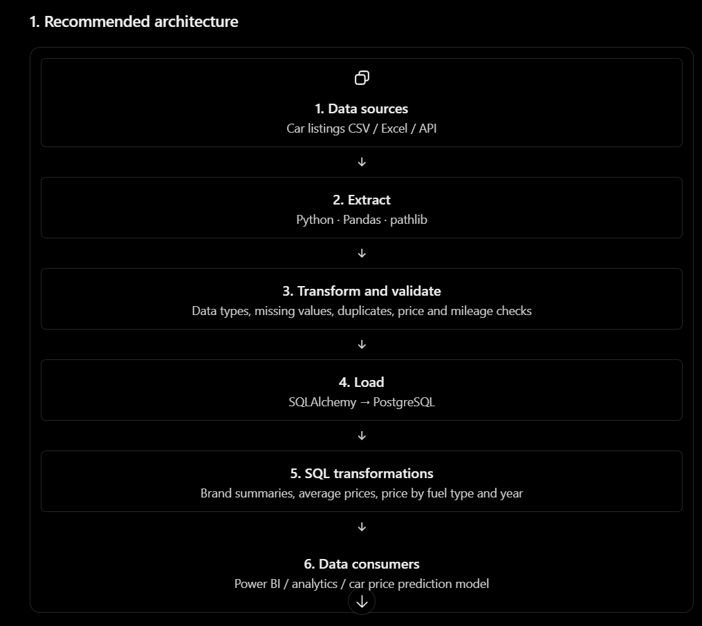
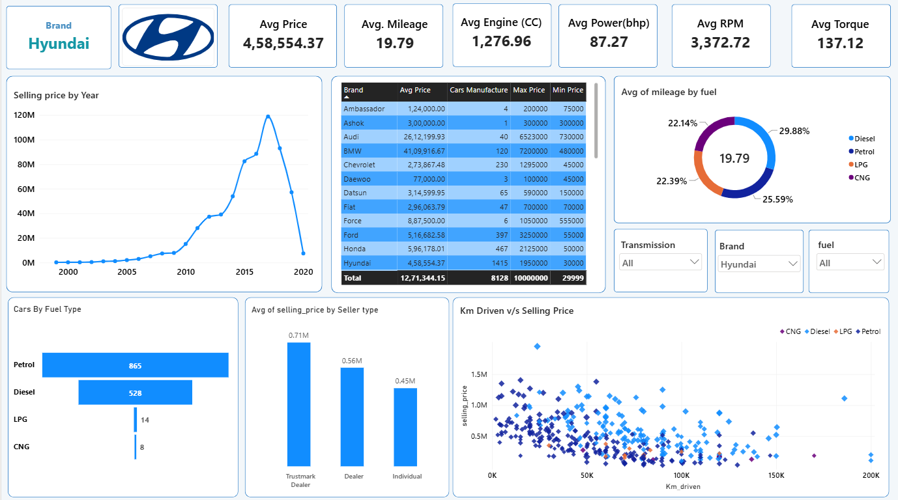

# 🚗 Car Price Analytics & Prediction

<div align="center">

  
  
  
  
  
  

  <br/><br/>

  **An End-to-End Data Engineering, Analytics & Price Prediction Project**

  Transforming raw used-car data into structured datasets, actionable business insights, and price analysis.

  <br/>

  <a href="https://github.com/Adiitya09">
    
  </a>

</div>

---

## 📌 Project Overview

**Car Price Analytics & Prediction** is an end-to-end data analytics project designed to explore the used-car market, prepare structured automotive datasets, analyze pricing patterns, and develop a foundation for car price prediction.

The project follows a structured data workflow, beginning with raw Excel datasets and progressing through data cleaning, transformation, PostgreSQL storage, SQL-based analysis, and interactive Power BI visualization.

The implementation focuses on building a reusable data pipeline using a **Bronze → Silver → Gold architecture**.

### 🎯 Project Objectives

- Build a structured ETL pipeline for used-car datasets.
- Clean and transform raw automotive data.
- Handle inconsistent and complex vehicle attributes.
- Store processed datasets in PostgreSQL.
- Perform analytical operations using SQL.
- Create reusable Gold-layer SQL views.
- Develop an interactive Power BI dashboard.
- Explore used-car pricing patterns and prediction opportunities.

---

## 🏗️ Data Engineering Architecture

The project follows a Medallion Architecture with three data layers.

<div align="center">

  

</div>

### 🔶 Bronze Layer — Raw Data

- Import original Excel datasets.
- Preserve source data for traceability.
- Load raw records into the initial data layer.

### ⚪ Silver Layer — Cleaned & Transformed Data

- Handle missing and inconsistent values.
- Remove duplicate records.
- Standardize column names and data types.
- Transform automotive attributes.
- Process complex fields such as Engine, Max Power, and Max Torque.
- Prepare structured datasets for analysis.

### 🟡 Gold Layer — Analytical Data

- Store analysis-ready data.
- Create reusable SQL views.
- Perform business-oriented aggregations.
- Prepare datasets for Power BI reporting.

---

## 🔄 ETL Workflow

| Stage | Process | Technology |
|---|---|---|
| 01 | Extract raw Excel data | Excel, Python |
| 02 | Data cleaning and preprocessing | Pandas |
| 03 | Data transformation | Python, Pandas |
| 04 | Load structured data | PostgreSQL |
| 05 | SQL analysis and transformations | SQL |
| 06 | Gold-layer analytical views | PostgreSQL |
| 07 | Dashboard development | Power BI |

---

## 📊 Power BI Dashboard

The interactive dashboard presents insights into used-car pricing and vehicle characteristics.

<div align="center">

  

  **Car Price Analytics Dashboard**

</div>

### Dashboard Highlights

- Key performance indicators (KPIs).
- Used-car price distribution.
- Vehicle and brand-level comparisons.
- Analysis of vehicle specifications.
- Interactive filtering and exploration.

---

## 🛠️ Technology Stack

| Category | Technologies |
|---|---|
| Programming | Python |
| Data Manipulation | Pandas, NumPy |
| Database | PostgreSQL |
| Query Language | SQL |
| Data Source | Microsoft Excel |
| Visualization | Power BI |
| Architecture | Bronze, Silver, Gold |
| Development | Jupyter Notebook, VS Code |
| Version Control | Git, GitHub |

---

## 📂 Project Structure

```text
Adiitya09-Car-Price-Analytics-Prediction/
│
├── Raw Data/
│   └── Original source datasets
│
├── Cleaned Data/
│   └── Processed and transformed datasets
│
├── Other data/
│   └── Supporting datasets and files
│
├── Pipeleine/
│   └── ETL pipeline resources
│
├── SQL/
│   └── SQL queries and analytical views
│
├── Car_Price_Dashboard_1.pbix
│
├── Car_price_Dashboard.png
│
├── Pipeline.png
│
└── README.md
```

---

## 💡 Key Learning Outcomes

- Implemented an end-to-end ETL workflow.
- Applied Bronze, Silver, and Gold data-layer concepts.
- Worked with real-world data cleaning challenges.
- Transformed complex automotive attributes into structured fields.
- Integrated Python-based preprocessing with PostgreSQL.
- Developed SQL queries and reusable analytical views.
- Connected structured data with Power BI for reporting.
- Applied data engineering principles to an analytics use case.

---

## ⚙️ Getting Started

### 1. Clone the Repository

```bash
git clone https://github.com/Adiitya09/Adiitya09-Car-Price-Analytics-Prediction.git
```

### 2. Navigate to the Project

```bash
cd Adiitya09-Car-Price-Analytics-Prediction
```

### 3. Install Dependencies

```bash
pip install pandas numpy sqlalchemy psycopg2-binary openpyxl jupyter
```

### 4. Configure PostgreSQL

Create a PostgreSQL database and configure your connection credentials.

Example SQL:

```sql
CREATE DATABASE car_price_analytics;
```

### 5. Explore the Project

- Explore the raw and cleaned datasets.
- Review the ETL pipeline resources.
- Execute the SQL scripts using PostgreSQL.
- Open the `.pbix` file in Power BI Desktop.

---

## 🚀 Future Enhancements

- Develop and evaluate regression models for car price prediction.
- Compare multiple machine learning algorithms.
- Build a prediction interface using FastAPI.
- Automate ETL execution and data refresh.
- Deploy the prediction application.
- Add model evaluation metrics and explainability.

---

## 👨‍💻 Author

<div align="center">

### Aditya Patil

**Computer Science & Business Systems Student**

<a href="https://github.com/Adiitya09">
  
</a>
<a href="https://www.linkedin.com/in/2004-aditya-patil/">
  
</a>
<a href="https://aditya-portfolio-xi-six.vercel.app/">
  
</a>

</div>

---

<div align="center">

**⭐ If you find this project useful, consider giving it a star!**

*Built with Python, SQL, PostgreSQL & Power BI.*

</div>
